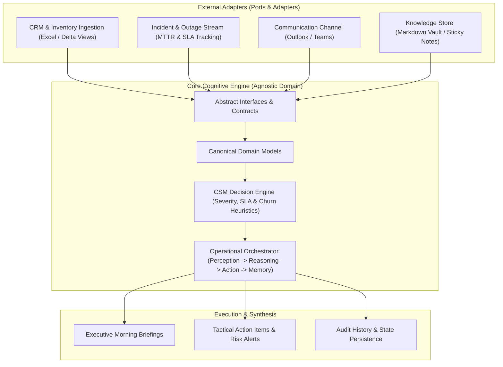

# Enterprise CSM Engine

[](https://www.python.org/downloads/)
[](#architecture-overview)
[](LICENSE)
[](#data-privacy--governance)

An autonomous, event-driven AI agent engine engineered to streamline **Customer Success Management (CSM)**, infrastructure governance, and operational intelligence for mission-critical enterprise accounts.

Built with **Clean Architecture (Ports & Adapters)**, the engine completely decouples operational reasoning from third-party enterprise platforms (CRM, ticketing, incident management, communication channels, and local knowledge stores).

---

## Architecture Overview

The system isolates domain rules from external data adapters. The core reasoning layer remains agnostic of third-party APIs and proprietary data formats.



### Architectural Principles

1. **Clean Architecture & Separation of Concerns:**
   * **`core/`**: Pure domain logic. Defines canonical business entities (`Customer`, `ServiceDelta`, `OutageIncident`, `DailyBriefing`) and abstract contracts. Zero external platform dependencies.
   * **`adapters/`**: Pluggable integration units translating external schemas into domain models.
   * **`config/`**: Zero hardcoding. Client portfolios, SLA thresholds, and operational parameters live strictly in configuration files.
   * **`state/`**: Persistent operational history tracking daily executions and state progression.

2. **Deterministic Token Optimization:**
   * Instead of dumping thousands of raw spreadsheet rows into an LLM context window, the engine processes local deltas.
   * Only meaningful state shifts (disconnects, activations, modifications, outages) reach the reasoning pipeline, reducing token overhead by over 90%.

3. **Human-in-the-Loop (HITL) Governance:**
   * The agent functions as an operational co-pilot. It synthesizes briefings, calculates MTTR breaches, and drafts executive minutes, but never sends outward-facing communications without explicit operator sign-off.

4. **Simulation Mode (Dry Run):**
   * Operations can be executed in simulation mode (`--dry-run`), allowing full evaluation of business rules and heuristic scoring without persisting changes or altering external stores.

---

## Repository Structure

```text
enterprise-csm-engine/
│
├── core/                         # Agnostic business logic
│   ├── __init__.py               # Core exports
│   ├── models.py                 # Canonical domain dataclasses
│   ├── interfaces.py             # Abstract ports (contracts)
│   ├── csm_logic.py              # SLA, churn, and severity heuristics
│   └── orchestrator.py           # Daily loop lifecycle controller
│
├── adapters/                     # System integrations
│   ├── __init__.py               # Adapter exports
│   ├── inventory_adapter.py      # Inventory & delta feed processor
│   ├── incident_adapter.py       # Ticket and outage monitor
│   ├── communication_adapter.py  # Communication thread inspector
│   └── vault_adapter.py          # Markdown knowledge store sync
│
├── config/                       # Configuration layer (Zero hardcoding)
│   ├── user_profile.example.yaml # Operator metadata and path configurations
│   ├── clients.example.yaml      # Client directory and domains (Synthetic)
│   └── settings.example.yaml     # P1/P2/P3 thresholds and MTTR limits
│
├── data/                         # Synthetic benchmark datasets
│   ├── sample_inventory_deltas.json
│   ├── sample_incidents.json
│   └── sample_communications.json
│
├── state/                        # Local memory & run logs
│   └── run_history.example.json  # Execution history state structure
│
├── tests/                        # Unit and integration test suites
│   ├── __init__.py
│   ├── test_csm_logic.py
│   └── test_orchestrator.py
│
├── main.py                       # Application entry point & CLI
├── requirements.txt              # Core dependencies
├── LICENSE                       # MIT License
└── README.md
```

---

## Getting Started

### Prerequisites
* Python 3.11 or higher
* Virtual environment tool (`venv` or `conda`)

### Installation

1. Clone the repository:
   ```bash
   git clone https://github.com/lramosmc/enterprise-csm-engine.git
   cd enterprise-csm-engine
   ```

2. Create and activate a virtual environment:
   ```bash
   python -m venv .venv
   # Windows:
   .venv\Scripts\activate
   # Linux/macOS:
   source .venv/bin/activate
   ```

3. Install dependencies:
   ```bash
   pip install -r requirements.txt
   ```

4. Configure your environment:
   ```bash
   cp config/user_profile.example.yaml config/user_profile.yaml
   cp config/clients.example.yaml config/clients.yaml
   cp config/settings.example.yaml config/settings.yaml
   ```

---

## CLI Usage

### 1. Default Morning Kickoff
Runs the full perception-to-memory cycle, generates the executive daily briefing, and records state:
```bash
python main.py
```

### 2. Simulation Mode (Dry Run)
Executes all heuristic checks, risk scoring, and rule processing without writing changes to disk or external stores:
```bash
python main.py --dry-run
```

### 3. Account-Specific Deep Dive
Runs an isolated diagnostic cycle on a single client account:
```bash
python main.py --client "Apex Cloud Infrastructure"
```

### 4. Query Previous Run Status
Inspects metrics, deltas, and flagged alerts from the latest recorded execution:
```bash
python main.py --status
```

---

## Running Automated Tests

Run the complete test suite using `pytest`:
```bash
pytest -v
```

---

## Data Privacy & Governance

This repository contains sanitized code and synthetic mock data only.
* All corporate client identities, account executive names, internal ticket numbers, and proprietary commercial terms have been replaced with synthetic benchmarks.
* The system is built around strict data boundary isolation: no proprietary business secrets or raw customer identifiable information (PII) are shared with public models.

---

## License

Distributed under the MIT License. See [LICENSE](LICENSE) for more information.
